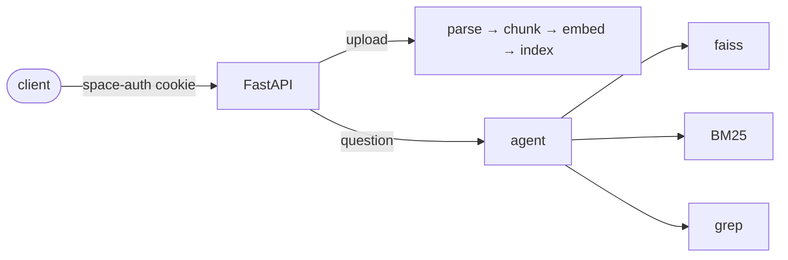

# ChillRAG

> A document RAG service — drop in a folder, ask questions across it.

Retrieval fuses three independent searchers — dense (**faiss**), lexical
(**BM25**) and literal (**grep**) — and answers come from an agent that can walk
a document's own structure before it commits to one.

The HTTP interface mirrors the hosted RAG vendor this service replaces, so an
existing client changes its base URL and nothing else.



## Quickstart

```bash
uv sync
uv run python -m app.users add alice --role admin      # prints a password
uv run uvicorn app.main:create_app --factory --workers 1 --host 0.0.0.0 --port 9022
```

Keep `--workers 1`: the source registry, ingest status and the embedder are all
per process.

## Accounts

Accounts are a gitignored `users.yaml` at the repo root, managed with the CLI:

```bash
uv run python -m app.users add alice --role admin    # or --password to choose one
uv run python -m app.users list
uv run python -m app.users passwd alice
uv run python -m app.users remove alice
```

`admin` manages sources; `user` asks and retrieves. The file is plain text, so
editing it by hand works too — either way the running service picks the change up
at the next login, with no restart:

```yaml
users:
  alice:
    password: "change-me"     # quote it if it contains # $ @ etc.
    role: admin
  bob:
    password: "..."
    role: user
```

Without the file, a single admin account falls back to `CHILLRAG_USER` /
`CHILLRAG_PASSWORD`. Tokens are signed with `CHILLRAG_AUTH_SECRET` (or a secret
generated once under the cache dir), so sessions survive a restart. A new
password does not end sessions already issued — they run 12 h; removing the
account, or changing the secret, does.

## Configure

| Variable | Purpose |
|---|---|
| `CHILLRAG_USERS_FILE` | Accounts file (default `users.yaml`) |
| `CHILLRAG_USER`, `CHILLRAG_PASSWORD` | Fallback single account when no users file |
| `CHILLRAG_AUTH_SECRET` | Token signing key (auto-generated if unset) |
| `CHILLRAG_MATERIALS_DIR` | Where uploaded folders are written |
| `CHILLRAG_CACHE_DIR` | Parsed documents, indexes and the service registry |
| `CHILLRAG_LLM_PROVIDER`, `CHILLRAG_MODEL`, `CHILLRAG_LLM_CONFIG_DIR` | Answer model |
| `EMBED_MODEL`, `EMBED_DEVICE` | Embedding model and device |

The remaining knobs are documented in `chillrag/config.py`.

## Endpoints

Everything except `/healthz` and login needs the `space-auth` cookie.

| Method and path | Purpose |
|---|---|
| `POST /space/api/passport/login` | Issue `space-auth` |
| `PUT /space/api/service/asset-file/resource` | Create a source (folder) |
| `POST /space/api/service/asset-file/web-upload?sourceId=` | Upload files; ingest runs in the background |
| `POST /space/api/service/asset-file` | Ingest status for a list of file ids |
| `POST /space/api/service/llmapi/ht/normal_rag_recall_without_doc_group` | Retrieval; parameters travel in the query string |
| `GET /space/api/service/asset-file/segments/{file_id}` | Whole-document readback |
| `POST /space/api/service/sse/llmapi/ht/text/post-answer` | Answer, streamed as SSE |

Responses use the envelope `{"code", "msg", "data"}`.

Two pages sit outside the protocol: `/` asks questions over a corpus, and
`/api-test` fires each endpoint above from a card — the quickest way to see what
a request and its response actually look like.

## Where it differs from the vendor

- `recall_content_types` is a union in the order given, so `["excel", "text"]`
  returns both, tables first. The vendor honours only the first type.
- `normal_rag_recall_without_doc_group` requires `source_ids`. The vendor falls
  back to a default source; this service has none.
- `post-answer` ignores `mode`.

## Layout

```
app/        HTTP layer — vendor-shaped routes, auth, background ingest
chillrag/   the core — parser, chunker, store, searchers, agent, LLM clients
tests/      contract tests, one per endpoint
```

## Test

```bash
uv run pytest
```
